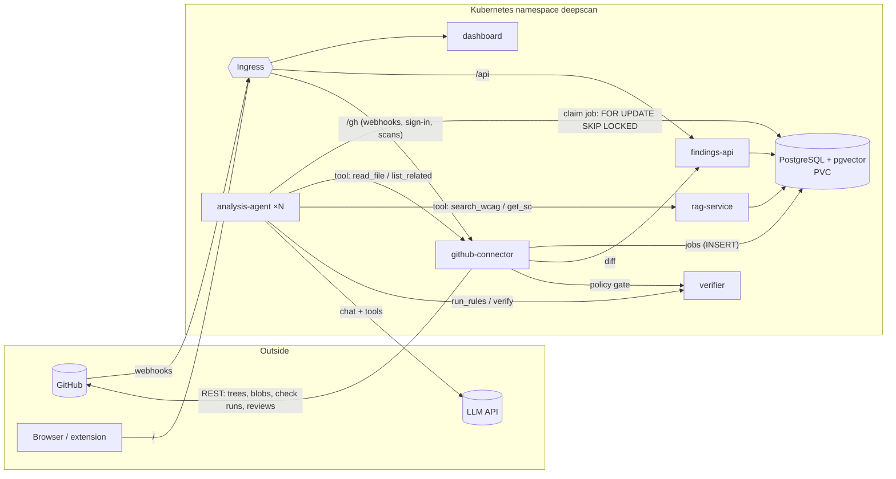

# Ariada DeepScan

A GitHub App that scans **whole repositories** for web-accessibility problems (WCAG 2.2), in the spirit of AI code-review bots, but built so that its AI findings can be trusted:

1. **An LLM agent** analyses each markup or style file. It grounds itself through **tool calls into a built-in RAG** over WCAG 2.2, the Techniques/Failures and the ARIA practices.
2. **A deterministic verifier** re-checks every AI finding. Each one is *verified* (reproduced by a rule), *rejected* (hallucinated snippet, wrong criterion or contradicted by the code) or *unverifiable* (real code, semantic issue: needs a human).
3. **A type-safe contract layer** (Zod) sits on every boundary: LLM tool calls, REST APIs, webhooks and the browser. An invented WCAG criterion never gets past it.

Results go back to GitHub as a Check Run with annotations, inline review comments and a summary comment. On pull requests, only *new* issues can fail the check. They also appear in a web dashboard that shows the repository tree being scanned live, and in a browser extension that outlines the issues on the live website.

PA2577 *Applied Cloud Computing and Big Data*, assignment "Build Something" by Alekszandr Bricskin.

---

## Architecture



| Component (responsibility) | Microservice | REST API (OpenAPI at `/openapi.json`) | Scales by |
|---|---|---|---|
| GitHub integration: webhook receiver (HMAC, dedupe, 202), App JWT → installation tokens, repo ingest (tree / PR files), result publisher (check runs, reviews, summary), GitHub sign-in | `github-connector` | `POST /gh/webhooks`, `POST /gh/scans`, `GET /gh/config`, `/gh/auth/*`, internal `GET /internal/scans/{id}/file`, `/related` | replicas (stateless; background loops use `SKIP LOCKED`) |
| AI analysis: queue worker + LLM tool loop (Anthropic, any OpenAI-compatible endpoint such as Ollama, or a deterministic mock) | `analysis-agent` | `POST /analyze` (synchronous, no queue) | competing consumers on `scan_jobs`, HPA |
| Knowledge base: hybrid retrieval (Postgres full-text + pgvector) over the WCAG 2.2 corpus | `rag-service` | `POST /search`, `GET /sc/{id}` | HPA (CPU) |
| Deterministic rules (17 rules), finding verification, fingerprints, policy gate | `verifier` | `POST /rules/run`, `POST /verify`, `POST /policy/evaluate` | HPA (CPU) |
| Read side: trees, progress, findings, version diff, plugin feed | `findings-api` | `GET /api/repos`, `/api/scans/{id}/tree`, `/progress`, `/findings`, `/api/scans/{a}/diff/{b}`, `GET /api/findings?site=` | HPA |
| Web UI (+ dev proxy) | `dashboard` | `GET /` | HPA |
| Persistence | PostgreSQL 16 + pgvector (StatefulSet + PVC) | — | single replica |

Shared code: `packages/contracts` holds the Zod schemas, which are the single source of truth for TS types, LLM tool JSON schemas, OpenAPI and runtime validation. `packages/platform` holds the Fastify bootstrap, health/metrics, the typed REST client and the database layer.

**Patterns:** queue-based load levelling + competing consumers (Postgres `FOR UPDATE SKIP LOCKED` with leases), webhook receiver + asynchronous request-reply, gateway routing (Ingress), CQRS-lite (write path via connector/agents, read path via findings-api), cache-aside (installation tokens, analysis cache by content hash, blob cache), idempotency (`X-GitHub-Delivery`, finding fingerprints), retry with backoff, health endpoint monitoring, gatekeeper (only the connector holds GitHub secrets), generator–verifier for the LLM.

## How one file is analysed

```
job ─▶ analysis-agent ─▶ verifier /rules/run              (deterministic findings, tier 1)
                     └─▶ LLM tool loop ─ search_wcag/get_sc ─▶ rag-service
                                       ─ read_file/list_related ─▶ github-connector
                                       ─ report_finding (Zod-validated)
                     └─▶ verifier /verify  ─▶ verified | rejected (+reason) | unverifiable
                     └─▶ findings (fingerprint = hash(SC, rule, path, element path))
```

---

## Run it

### 1. Locally, no containers (fastest feedback)

Needs Node 22, pnpm and PostgreSQL 16 with pgvector on `localhost:5432` (user/password/db `deepscan`).

```bash
pnpm install
pnpm test               # 20 unit tests
./scripts/dev-up.sh     # starts all six services; dashboard on http://localhost:8080
```

Click **Scan the demo repository**. The demo repository (`fixtures/demo-site`) contains HTML, React, Vue, Svelte and CSS with deliberate accessibility defects.

### 2. Docker Compose

```bash
docker compose up --build      # http://localhost:8080
```

### 3. Kubernetes

```bash
# build multi-arch images (amd64 + arm64) and push them to Docker Hub
docker login
DOCKERHUB_USER=<you> TAG=1.0.0 ./scripts/build-push.sh

# deploy to the current kubectl context (Docker Desktop, minikube, kind, AKS/GKE/EKS…)
./scripts/deploy.sh            # creates k8s/secrets/*.env (random DB password) on first run

kubectl -n deepscan port-forward svc/dashboard 8080:8080     # → http://localhost:8080
```

With an ingress-nginx controller installed, the app is also served on the controller's address. The HPAs need `metrics-server`. The NetworkPolicies need a CNI that enforces them (Calico or Cilium; Docker Desktop ignores them).

Useful commands for the demo:

```bash
kubectl -n deepscan get pods,svc,pvc,hpa,ingress
kubectl -n deepscan patch hpa analysis-agent -p '{"spec":{"minReplicas":6}}'   # scale agents (HPA-managed)
kubectl -n deepscan logs -l app.kubernetes.io/name=analysis-agent -f --max-log-requests 10 | grep -E 'tool call|file analysed|rejected'
kubectl -n deepscan logs deploy/verifier -f
kubectl -n deepscan delete pod postgres-0      # data survives: it lives on the PVC
```

### 4. Connect a real GitHub App (optional)

1. Go to *GitHub → Settings → Developer settings → GitHub Apps → New GitHub App*.
2. Set the webhook URL to `https://<public-host>/gh/webhooks` and set a webhook secret. For a local cluster, a tunnel works: `cloudflared tunnel --url http://localhost:8080`.
3. Set the callback URL to `https://<public-host>/gh/auth/callback`.
4. Grant these repository permissions: **Contents: read**, **Metadata: read**, **Pull requests: write**, **Checks: write**, **Issues: write** (for the summary comment).
5. Subscribe to these events: Installation, Installation repositories, Pull request, Push, Issue comment.
6. Put the App ID, slug, base64 private key, webhook secret, client ID and client secret into `k8s/secrets/github.env` (mounted only into `github-connector`). Set `PUBLIC_URL` in `k8s/config.yaml`, then re-run `./scripts/deploy.sh`.

In a PR you can comment `@ariada-deepscan rescan` or `@ariada-deepscan ignore <fingerprint> <reason>`.

`scripts/fake-github.mjs` is a GitHub API simulator. It was used to test the complete App flow (install → baseline scan → PR → check run, review and summary) without a real App.

### 5. Use a real LLM

The default `LLM_PROVIDER=mock` is a scripted agent. It needs no API key, behaves like a tool-calling model and deliberately produces the failure modes the architecture defends against: an invented criterion, a fabricated snippet and a contradicted claim. For a real model:

* Anthropic: set `LLM_PROVIDER=anthropic` and put `ANTHROPIC_API_KEY` in `k8s/secrets/llm.env` (mounted only into `analysis-agent`) (model set by `ANTHROPIC_MODEL`).
* Local or open models: set `LLM_PROVIDER=openai`, `OPENAI_BASE_URL=http://ollama:11434/v1` and `OPENAI_MODEL=qwen2.5-coder:7b` (any OpenAI-compatible server with tool calling). Allow the agent's egress to that service.

### 6. Browser extension

Load `extension/` as an unpacked extension (`chrome://extensions` → Developer mode) and set the DeepScan URL in its options. When you visit a site whose URL is set as the repository's homepage, verified findings from the latest default-branch scan are outlined on the page.

---

## Repository layout

```
packages/contracts     Zod contracts: WCAG 2.2 catalog, findings, tool schemas, REST + webhook schemas
packages/platform      service bootstrap, metrics, typed REST client, DB schema/migrations, sessions
services/*             the six microservices (each bundled into one file by esbuild)
services/rag-service/corpus   WCAG knowledge base (summaries with links to the W3C sources)
fixtures/demo-site     demo repository with seeded accessibility defects
k8s/                   Kustomize manifests (namespace, config, secrets, postgres, services, HPA, ingress, network policies)
extension/             Chrome MV3 overlay
scripts/               dev-up, bundle, build-push, deploy, fake-github
docs/                  report and video script
```

## License

[EUPL-1.2](LICENSE), the same licence as [ariada](https://github.com/ariada-org/ariada).
