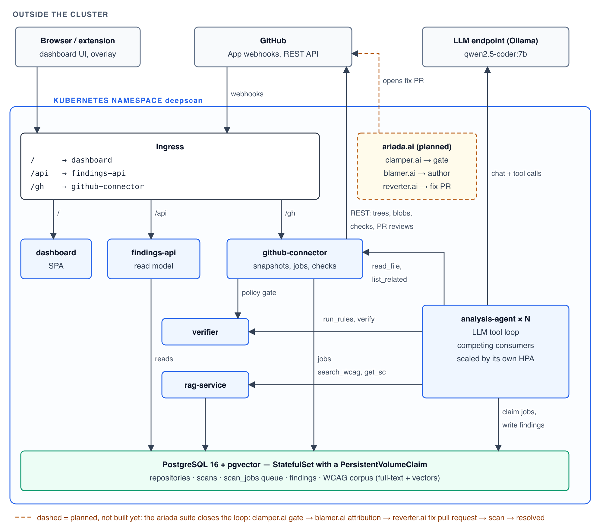
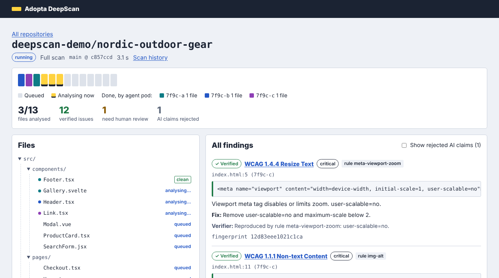
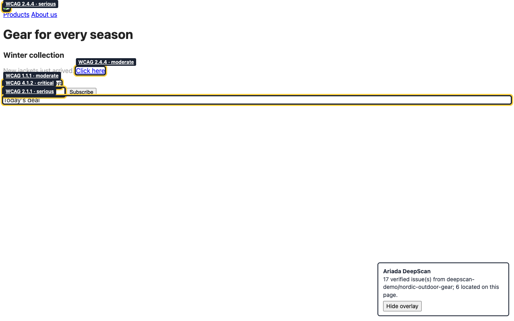

# Build Something - Ariada DeepScan

*PA2577 Applied Cloud Computing and Big Data · Alekszandr Bricskin*

- Source code and Kubernetes deployment: https://github.com/ariada-org/ariada-deepscan (`k8s/` holds the manifests; images on Docker Hub as [`ariadaorg/deepscan-<service>`](https://hub.docker.com/u/ariadaorg), versions pinned in `k8s/kustomization.yaml`)
- Video: `<link to the recording>`

## 1. What the software does

Ariada DeepScan is a GitHub App that audits a whole repository for web-accessibility problems against WCAG 2.2. It also audits every pull request incrementally. It is aimed at teams that must comply with accessibility law (EU Accessibility Act, Section 508) and that today rely on page-by-page browser scanners, which only see rendered pages. They do not see the repository, and they cannot say *which change* introduced a problem.

For every markup or style file (HTML, JSX/TSX, Vue, Svelte, CSS) the system does three things:

1. Runs **deterministic rules**, e.g. missing `alt`, unlabeled form fields, icon-only buttons, colour contrast computed from CSS, focus outline removed, viewport zoom disabled.
2. Lets an **LLM agent** look for issues that need judgement, such as non-descriptive alt text, placeholder-only instructions or colour-only error states. The agent grounds itself by calling tools: a **built-in RAG** over WCAG 2.2, the Understanding documents, Techniques, Failures and ARIA practices, plus read-only access to related files.
3. Sends every AI finding through a **deterministic verifier**:
   - **verified**: a rule reproduces it;
   - **rejected**: the snippet does not exist, the criterion does not apply to the element, or a rule contradicts the claim;
   - **unverifiable**: the code is real, but the issue is semantic and needs a human.

Every finding gets a structural **fingerprint** that is stable across line shifts. Pull requests are compared with the scan of their base commit, which classifies each finding as **new**, **fixed** or **pre-existing**. Only new, verified findings of blocking severity fail the GitHub check. Results are published as a Check Run with annotations, inline review comments and a summary comment. They are also shown in a web dashboard that displays the repository tree while it is being scanned, and in a browser extension that outlines the issues on the live website.

Once the issues are fixed, the system checks the fix by itself. A push to the default branch starts a new full scan, and every new commit on a pull request re-scans it. In the dashboard, a *Rescan* button on the scan and history pages does the same by hand, and *What changed since the previous scan* lists which issues are fixed, which are new and which are still there.

**Scale assumption.** The demo repository has 13 analysable files, which does not need scaling. To make the architecture meaningful, assume a SaaS that serves organisations with thousands of repositories and hundreds of pull requests per day, where each file costs an LLM round trip of several seconds. In the default configuration the mock LLM simulates this latency (`MOCK_DELAY_MS`).

## 2. Architecture

[](assets/architecture.svg)

Everything drawn with solid lines is built and deployed. The dashed boxes on the right are not part of this deployment and are not connected yet: clamper.ai, blamer.ai and reverter.ai, the Ariada products that would take DeepScan's findings on to a gate, an author and a fix (section 5).

The same diagram as text:

<!-- architecture:begin (generated by scripts/architecture.mjs) -->
```text
 OUTSIDE THE CLUSTER
 ┌──────────────────────┐         ┌────────────────────────────┐            ┌──────────────────────────┐
 │ Browser / extension  │         │ GitHub                     │            │ LLM endpoint (Ollama)    │
 │ dashboard UI, overlay│         │ App webhooks, REST API     │            │ qwen2.5-coder:7b         │
 └──────────────────────┘         └────────────────────────────┘            └──────────────────────────┘
     │                                  │                 ▲   ▲                         ▲                     opens fix PR
     │                                  │webhooks         └┄┄┄┼┄┄┄┄┄┄┄┄┄┄┄┄┄┄┄┄┄┄┄┄┄┄┄┄┄│┄┄┄┄┄┄┄┄┄┄┄┄┄┄┄┄┄┄┄┄┄┄┄┄┄┄┄┄┄┄┄┄┄┄┄┄┄┄┄┄┄┄┄┄┄┄┄┐
╔════╪═ KUBERNETES NAMESPACE deepscan ══╪═════════════════════╪═════════════════════════╪══════════════════╗                            ┆
║    ▼                                  ▼                     │                         │                  ║  findings + baseline       ┆
║ ┌──────────────────────────────────────────────────────┐    │                         │                  ║  ┌┄┄┄┄┄┄┄┄┄┄┄┄┄┄┄┄┄┄┄┄┄┄┄┐ ┆
║ │ Ingress                                              │    │                         │                  ║┄▶┆ clamper.ai (planned)  ┆ ┆
║ │ /      → dashboard                                   │    │                         │                  ║  ┆ gate: new findings    ┆ ┆
║ │ /api   → findings-api                                │    │                         │chat + tool calls ║  └┄┄┄┄┄┄┄┄┄┄┄┄┄┄┄┄┄┄┄┄┄┄┄┘ ┆
║ │ /gh    → github-connector                            │    │                         │                  ║              ┆ failed check┆
║ └──────────────────────────────────────────────────────┘    │                         │                  ║              ▼             ┆
║       │/                │/api                   │/gh        │REST: trees, blobs,      │                  ║  ┌┄┄┄┄┄┄┄┄┄┄┄┄┄┄┄┄┄┄┄┄┄┄┄┐ ┆
║       ▼                 ▼                       ▼           │checks, PR reviews       │                  ║  ┆ blamer.ai (planned)   ┆ ┆
║ ┌────────────┐  ┌────────────────┐    ┌────────────────────────┐                      │                  ║  ┆ who: commit, human/AI ┆ ┆
║ │ dashboard  │  │ findings-api   │    │ github-connector       │◀─────────────┐       │                  ║  └┄┄┄┄┄┄┄┄┄┄┄┄┄┄┄┄┄┄┄┄┄┄┄┘ ┆
║ │ SPA        │  │ read model     │    │ snapshots, jobs, checks│ read_file,   │       │                  ║              ┆ who, commit ┆
║ └────────────┘  └────────────────┘    └────────────────────────┘ list_related │       │                  ║              ▼             ┆
║                         │               │policy gate  │                       │       │                  ║  ┌┄┄┄┄┄┄┄┄┄┄┄┄┄┄┄┄┄┄┄┄┄┄┄┐ ┆
║                         │               ▼             │                   ┌──────────────────────────┐   ║  ┆ reverter.ai (planned) ┆ ┆
║                         │ ┌───────────────┐           │ run_rules, verify │ analysis-agent × N       │   ║  ┆ fix PR or rollback    ┆┄┘
║                         │ │ verifier      │◀──────────┼───────────────────│ LLM tool loop            │   ║  └┄┄┄┄┄┄┄┄┄┄┄┄┄┄┄┄┄┄┄┄┄┄┄┘
║                         │ └───────────────┘           │                   │ competing consumers      │   ║  code ↔ page, file:line
║                         │reads                        │jobs               │ scaled by its own HPA    │   ║  ┌┄┄┄┄┄┄┄┄┄┄┄┄┄┄┄┄┄┄┄┄┄┄┄┐
║                         │ ┌───────────────┐           │search_wcag, get_sc│                          │   ║  ┆ one plugin (planned)  ┆
║                         │ │ rag-service   │◀──────────┼───────────────────│                          │   ║┄▶┆ core + adapters:      ┆
║                         │ └───────────────┘           │                   └──────────────────────────┘   ║  ┆ browser · IDE · CMS   ┆
║                         │         │                   │                                 │claim jobs,     ║  └┄┄┄┄┄┄┄┄┄┄┄┄┄┄┄┄┄┄┄┄┄┄┄┘
║                         │         │                   │                                 │write findings  ║  findings as files
║                         ▼         ▼                   ▼                                 ▼                ║  ┌┄┄┄┄┄┄┄┄┄┄┄┄┄┄┄┄┄┄┄┄┄┄┄┐
║ ┌────────────────────────────────────────────────────────────────────────────────────────────────────┐   ║  ┆ exports (planned)     ┆
║ │ PostgreSQL 16 + pgvector — StatefulSet with a PersistentVolumeClaim                                │   ║┄▶┆ SARIF · JUnit · EARL  ┆
║ │ repositories · scans · scan_jobs queue · findings · WCAG corpus (full-text + vectors)              │   ║  ┆ ACR/VPAT · statement  ┆
║ └────────────────────────────────────────────────────────────────────────────────────────────────────┘   ║  └┄┄┄┄┄┄┄┄┄┄┄┄┄┄┄┄┄┄┄┄┄┄┄┘
╚══════════════════════════════════════════════════════════════════════════════════════════════════════════╝
 ┄┄ dashed = planned: clamper.ai gate → blamer.ai who → reverter.ai fix PR → rescan; one plugin, many adapters; standard exports
```
<!-- architecture:end -->



### Components and their microservices

| Component | Responsibility | Microservice |
|---|---|---|
| GitHub integration | Receives and authenticates webhooks; obtains installation tokens from the App's private key; snapshots repository trees and PR file lists; publishes check runs, reviews and comments; signs users in. It is the only component that holds GitHub secrets. | `github-connector` |
| Analysis | Takes file jobs from the queue; runs the LLM tool loop; caches results by content hash; writes findings. | `analysis-agent` |
| Knowledge base | Hybrid retrieval (PostgreSQL full-text + pgvector embeddings, fused with Reciprocal Rank Fusion) over 158 WCAG documents; criterion details. | `rag-service` |
| Verification and policy | Rules engine over a framework-neutral element model (HTML via parse5, JSX/TSX via Babel, Vue/Svelte templates, CSS via PostCSS); verification of candidates; fingerprints; PR policy gate. Stateless and CPU-bound. | `verifier` |
| Read model | Trees with per-file status, scan progress, findings, version diffs, plugin feed; authorisation of the viewer. | `findings-api` |
| User interface | Dashboard SPA; strict CSP; local proxy for `/api` and `/gh`. | `dashboard` |
| Persistence | Repositories, scans, the job queue, findings, baselines, exemptions, the RAG corpus, sessions. | PostgreSQL 16 + pgvector (StatefulSet with a PersistentVolumeClaim) |
| Type-safe contract layer | Zod schemas shared by every service and the browser. They generate the TypeScript types, the JSON Schemas of the LLM tools and the OpenAPI documents, and they validate every boundary at runtime. | library `packages/contracts` (not a service: a network hop just to validate would be an anti-pattern) |

### How the services interact

- **Webhook receiver + asynchronous request-reply.** GitHub expects an answer within 10 s. The connector verifies the HMAC, stores the delivery (deduplicated by `X-GitHub-Delivery`) and answers `202` at once. A background worker processes deliveries.
- **Queue-based load levelling with competing consumers.** A scan becomes one row per file in `scan_jobs`. Agent replicas claim rows with `SELECT … FOR UPDATE SKIP LOCKED` and a lease (`locked_until`). If a pod dies, its job becomes claimable again when the lease expires (max 3 attempts). The last finisher marks the scan complete under a row lock on the scan, so concurrent finishers cannot race.
- **Synchronous REST for tools.** The agent calls the connector (`read_file`, `list_related`), the RAG (`search_wcag`, `get_sc`) and the verifier (`run_rules`, `verify`). Every response is validated against its contract by the typed REST client.
- **CQRS-lite.** Writes go through the connector and the agents. All reads for the UI, the plugin and the publisher go through `findings-api`.
- **Gateway routing.** One Ingress maps `/` to the dashboard, `/api` to findings-api and `/gh` to the connector. `/internal/*` is never routed.
- **Cache-aside.** Installation tokens are cached for 55 minutes, file contents by blob SHA, and analysis results by `hash(prompt version, model, content)`. Unchanged files therefore cost no LLM call on the next scan.
- **Generator-verifier.** The LLM proposes and deterministic code decides. The type layer, the verifier and the human reviewer are three successive filters against hallucinations.

### Deployment

Each microservice is a Deployment with its own Service, its own HorizontalPodAutoscaler, readiness and liveness probes, and resource requests and limits. They are built from a single multi-stage Dockerfile: esbuild bundles each service into one file, which runs on `node:22-alpine` as a non-root user. Images are multi-arch (amd64/arm64) on Docker Hub.

PostgreSQL is a StatefulSet whose `volumeClaimTemplate` keeps data across pod and cluster restarts. The RAG corpus is loaded by an init container of `rag-service`; it is idempotent and runs under a Postgres advisory lock, as do the schema migrations. Configuration lives in a ConfigMap. Secrets are three Kustomize-generated Secrets: database, GitHub App and LLM, each mounted only into the services that need it. The namespace enforces the Pod Security *restricted* profile.

The language model is not part of the deployment. It is an external endpoint that `analysis-agent` calls over REST: a local Ollama server with `qwen2.5-coder:7b` in the demo, a hosted model in production. The same goes for the GitHub REST API. All six microservices in the cluster were written for this project; the only third-party container is PostgreSQL.

### Testing

- 20 unit tests: rules and verifier, contract layer, webhook signatures and sanitising. Typecheck of all services, including the browser code.
- End-to-end: the bundled services ran against PostgreSQL + pgvector. A full scan of the demo repository was split across three agent replicas. Postgres was restarted in the middle of a scan; all services reconnected and the scan completed.
- The GitHub App flow (installation → baseline scan → pull request → failing check run, inline review comments, summary comment) was tested against a GitHub API simulator (`scripts/fake-github.mjs`). Forged signatures get 401; repeated deliveries are ignored.
- CI (`.github/workflows/ci.yml`) builds all images, deploys `k8s/` to a kind Kubernetes cluster, scans the demo repository through the dashboard, checks that both agent replicas took jobs, and deletes the Postgres pod to show that the data survives on the PVC.



## 3. Benefits, challenges and mitigations

### Benefits

- **Independent scaling where the cost is.** LLM latency dominates, so only `analysis-agent` needs many replicas; `verifier` and `rag-service` scale on CPU. A burst of pull requests grows the queue, not the error rate.
- **Resilience.** Agents are stateless and jobs are leased, so killing a pod delays a file instead of losing it. GitHub always gets a fast `202`, and a failed GitHub call is retried from the stored delivery.
- **Trustworthy AI output.** Precision is measured (verified / unverifiable / rejected per scan), and only verified findings can block a merge. That is the business precondition for teams accepting an AI gate.
- **Cost control.** Deterministic rules handle the cheap, certain cases. The content-hash cache and PR-only analysis (changed files only) cut LLM spend, which is the main variable cost of the product.
- **Replaceable model.** The provider interface supports Anthropic, any OpenAI-compatible endpoint (including a self-hosted Ollama for customers who cannot send code to a third party) and a mock.

### Challenges and what was done or can be done

| Challenge | Mitigation (done / possible) |
|---|---|
| PostgreSQL is a single point of failure and a shared bottleneck (queue + data + vectors). | Done: connection pooling, short transactions, partial indexes for the queue, advisory-lock migrations. Possible: managed Postgres with a standby, read replicas for `findings-api`, a dedicated broker (NATS/SQS) for the queue. |
| CPU-based HPA is a poor signal for I/O-bound agents. | Possible: KEDA scaling on the length of `scan_jobs` (a SQL scaler). |
| LLM latency, rate limits and cost. | Done: bounded turns and tool calls per file, retries with backoff, caching, rules first, changed files only on PRs. |
| GitHub API rate limits per installation. | Done: cached tokens and blobs, file contents of public repositories via the raw CDN, annotations batched by 50. Possible: ETag conditional requests, honouring `Retry-After`. |
| Static analysis cannot see runtime DOM, computed styles or dynamic values. | Done: rules return "cannot decide" for dynamic values instead of guessing. Possible: a worker type that renders pages in a headless browser. |
| Webhooks need a public endpoint. | Ingress + TLS in the cloud; a tunnel (cloudflared) for local clusters. |
| Fingerprints change when a file is renamed. | Renames show up as fixed + new. Possible: map renames from the PR file list. |

### Security

| Threat | Mitigation |
|---|---|
| Forged webhooks | HMAC-SHA256 over the raw body with constant-time comparison; delivery-ID de-duplication against replay; size limit. |
| Leaked or over-privileged GitHub credentials | GitHub App instead of personal tokens: short-lived (1 h) installation tokens scoped to the installation, minimal permissions (contents read, checks/pull requests write). The private key exists only in the connector's Secret. NetworkPolicy allows egress to the internet only from the connector and the agent. |
| Kubernetes Secrets are only base64-encoded | Possible: Sealed Secrets or External Secrets with a cloud KMS, and encryption at rest for etcd. Secrets are split by need-to-know: database credentials go to the four DB clients, the GitHub App key only to the connector and the LLM key only to the agent. `k8s/secrets/*.env` is git-ignored, and `deploy.sh` generates it with random passwords. |
| Untrusted repository content | Never executed: only parsed. File size and file count limits. Tool paths are branded `RepoPath` values (no absolute paths, no `..`) and must exist in the snapshot. |
| Prompt injection via repository content | The file is passed as data with an explicit instruction to ignore embedded instructions. Tools are read-only, scoped to one snapshot, and include no network tools. Budgets on turns and tool calls. Every claim is re-verified. Text posted to GitHub comes from a fixed template, and LLM text is sanitised (no HTML, links or @-mentions). |
| Hallucinated or malformed model output | Zod validation of every tool call, with the error returned to the model as a repair loop; the closed WCAG enum; the deterministic verifier. |
| SSRF through "scan this URL" | Only `https://github.com/{owner}/{repo}` is accepted (regex + brand type). File contents are fetched from fixed GitHub hosts. Egress to private ranges and `169.254.169.254` is blocked by NetworkPolicy. |
| Unauthorised access to private results | Sign in with GitHub. The session stores the user's installation IDs; findings of App-installed repositories are only visible to users with access to that installation, and missing access returns 404, not 403. Cookies are httpOnly, SameSite=Lax and Secure under HTTPS, with an OAuth `state` check. The user's OAuth token is discarded after login. |
| Abuse of anonymous scans | Public scans can be disabled; a per-IP rate limit and an optional API key. Possible: a shared rate limit (Redis) and a global request rate at the Ingress (an annotation is set). |
| Browser attacks on the dashboard | Strict CSP (no inline scripts), `X-Frame-Options: DENY`, `nosniff`, no `innerHTML` with data (DOM APIs only). |
| Lateral movement in the cluster | Default-deny NetworkPolicies, with only the calls in the diagram allowed. Pods run non-root with a read-only root filesystem, all capabilities dropped and the RuntimeDefault seccomp profile. Service-account tokens are not mounted. |
| Supply chain | A single bundled JS file per image, no package manager at runtime, frozen lockfile. Possible: image scanning (Trivy) and signing (cosign) in CI. |

## 4. Business implications of the design

- **Pay for what is used.** Cost scales with the number of changed files analysed by the LLM, and the queue makes that work elastic. Price per active repository or per analysed file maps directly onto the cost driver.
- **Trust as a feature.** The verified/unverifiable split turns AI output into something an organisation can gate merges on and show to auditors. The fingerprint baseline means a team with an existing backlog can adopt the gate without being blocked on day one.
- **Data residency and model choice.** The provider abstraction allows an on-premise or EU-hosted model, which is a sales requirement in regulated sectors.
- **Lock-in.** The system is portable: plain Kubernetes, PostgreSQL and REST. The only external dependencies are GitHub and the LLM API.

## 5. What comes next

**Closing the loop from finding to fix.** Today the loop is closed only on the checking side. A developer fixes the code, the push or the pull request is scanned again, and the comparison with the previous scan shows the issue as fixed. The fixing itself is still done by a person. The next step is a fix step that takes the verified findings of a scan, writes a patch for those with a safe, local fix (a missing `lang`, an icon button without a name, a removed focus outline, a form field without a label), and opens a pull request with it. That pull request then goes through the same pipeline as any other. It is scanned against its base, and the check passes only if the findings it targets come back as fixed and no new ones appear. A person still reviews and merges it. Findings that need judgement, such as whether an alt text actually describes the image, stay with people.

**DeepScan as the scanning core of the Ariada products.** The fix step does not have to be written from scratch. DeepScan is published under the Ariada project, and within that family it is the scanning core: it finds problems and says exactly where they are. Each step after detection is a separate Ariada product, and the products share one finding format with fingerprints and a baseline policy, so DeepScan's findings can be handed on as they are. The diagram draws the three of them dashed, next to the cluster. clamper.ai is the gate: it compares the findings of a change with its baseline and blocks only the new ones. That is what DeepScan's pull-request check does today, so the check can move onto the shared gate. blamer.ai is attribution: it finds the commit that introduced a regression and its author, and whether that code was written by a person or by an AI coding assistant. DeepScan already knows the file and the line of every finding, which is exactly what that question needs. reverter.ai is the fix: it fixes the simple cases deterministically, hands the rest to a language model, and opens a draft fix pull request, or rolls the change back. What is missing is the wiring, since the products do not call each other yet. The work is a small orchestrator in `github-connector` that passes a failed check to blamer.ai and the result on to reverter.ai, plus one integration test that runs the whole loop once. Little has to change inside DeepScan itself, because the fix pull request comes back through the same webhook path as a human one and is judged by the same deterministic verifier.

**More scan domains.** The first domain is web accessibility, because that is where the law (the European Accessibility Act) creates demand now. Nothing in the architecture is tied to it, though. The rules work on a framework-neutral element model, the knowledge base is a corpus loaded into `rag-service`, the list of valid criteria is an enum in the contract layer, and fingerprints, baselines and the pull-request gate do not care what a finding is about. Other domains can be added the same way, each with its own rule pack, corpus and criteria list. Ariada's domain catalogue already names them. Next to accessibility, the core domains are security (unsafe HTML injection, missing security headers, secrets in client code), privacy (trackers and cookies loaded before consent, in the GDPR sense), sustainability (page weight and wasted transfers), AI readiness (whether crawlers and language models can read the site) and structured data. After those come performance, search, localization and reliability. Each domain can get its own job queue and agent Deployment, so a heavy domain scales without slowing the others.

**One plugin, many adapters.** DeepScan has a small browser extension of its own, which outlines the findings from the repository on the live site. Ariada also has a side-panel extension that scans the open page itself, locally, and an editor extension for VS Code (Visual Studio Code) and JetBrains IDEs (integrated development environments) that marks problems inline while the code is being written. These are the same idea seen from different places, and they should be one plugin: a shared core that holds the rule modules, the finding format and the connection to DeepScan, with a thin adapter for each place it runs in. The browser adapter works from the page towards the code: click an element and land on its file and line. The editor adapter works from the code towards the page: a finding in the editor shows where it appears on the live site. A CMS (content management system) adapter, for WordPress, Drupal or Shopify themes, does the same for people who never open a repository. Ariada already plans connectors for about two hundred CMS, hosting, shop and CI (continuous integration) platforms, and they would all be adapters of this one core. Because every adapter runs the same rules, the browser, the editor and the repository give the same answer.

**Seeing the code behind a finding.** The dashboard now names the file and the line but does not show them. The next version shows the code itself with the offending lines highlighted, and a link that opens the same place in the developer's own editor (`vscode://file/<path>:<line>` and its JetBrains equivalent). For people without a local checkout, a read-only built-in viewer with the same highlighting is enough.

**Reports in standard formats.** Today the results live in the dashboard and in GitHub comments, which is enough for a developer but not for anyone who has to hand evidence on. The plan is a set of exports, each for a specific reader. SARIF 2.1.0 (Static Analysis Results Interchange Format) goes into GitHub code scanning and is read by GitLab, Azure DevOps and SonarQube as well. JUnit XML lets any CI server show the findings as failed tests, and GitLab's Code Quality JSON puts them into merge requests. For auditors there is EARL (the W3C Evaluation and Report Language) and a report in the WCAG-EM (WCAG Evaluation Methodology) structure. For buyers and public authorities there is an ACR (Accessibility Conformance Report) in the VPAT 2.5 (Voluntary Product Accessibility Template) format with the EN 301 549 tables, and a draft accessibility statement in the form the EU Web Accessibility Directive requires (in Sweden the DIGG template). A CSV or spreadsheet export covers everything else. Ariada already has emitters for SARIF, VPAT and EN 301 549, so most of this is wiring DeepScan's findings into them.

**Scaling on the right signal.** The agents are scaled on CPU today, which is a weak signal for work that mostly waits for the model. Scaling on the length of the job queue with KEDA (Kubernetes Event-driven Autoscaling) is the next change to the deployment.

## 6. Use of generative AI

Generative AI (Claude) was used as a programming assistant while designing and implementing this project. All code was reviewed, run and tested by the author; the design decisions and their justification are the author's.
